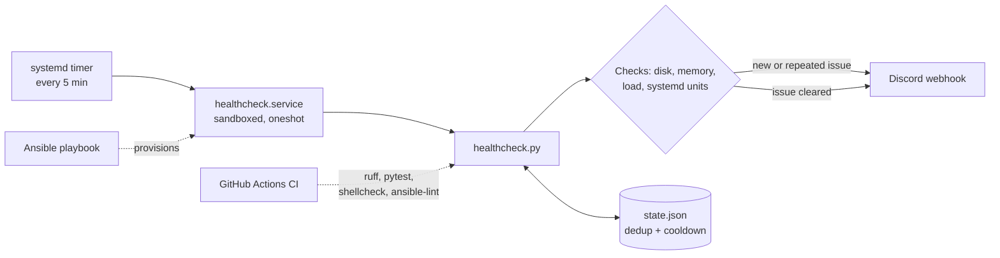
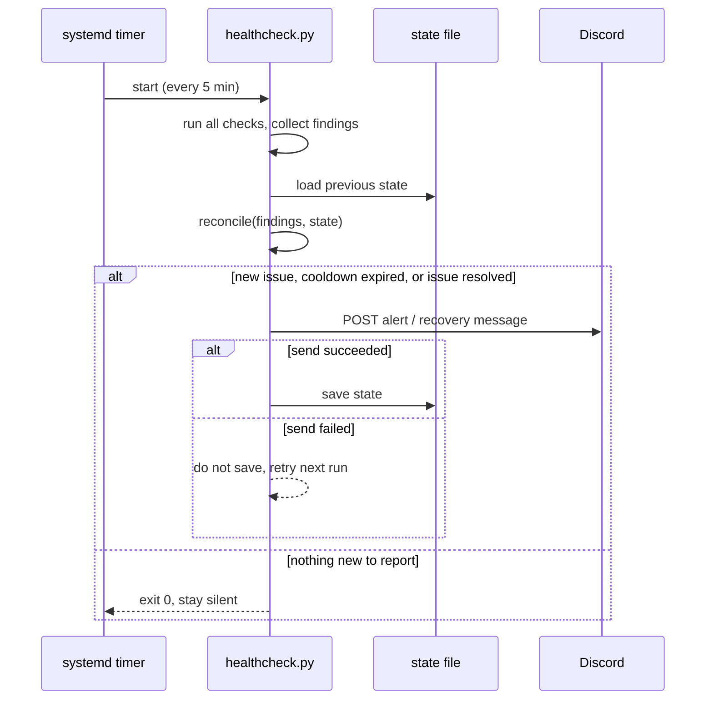
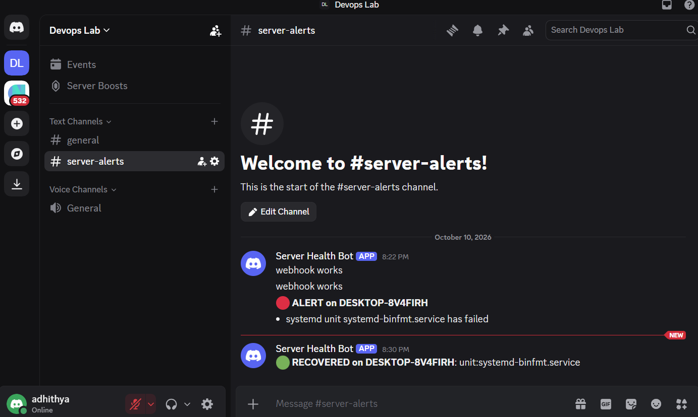
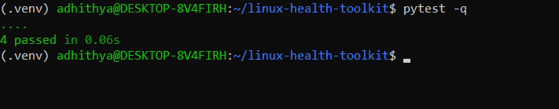
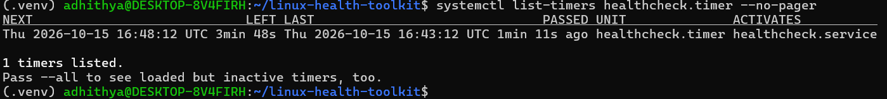
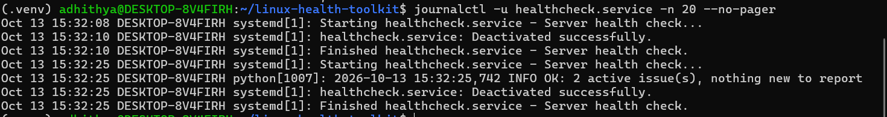
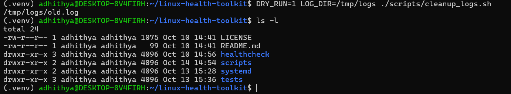
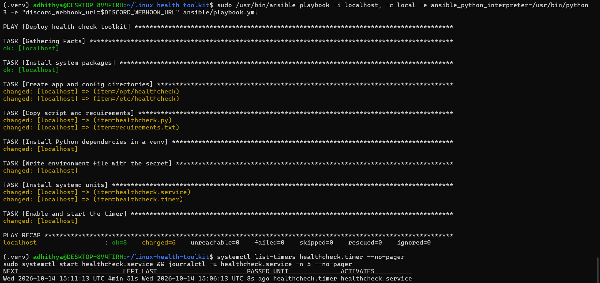
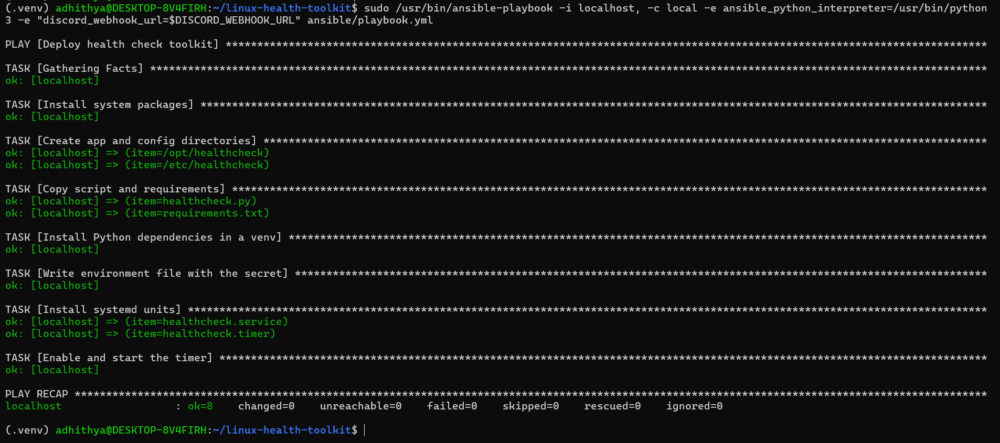
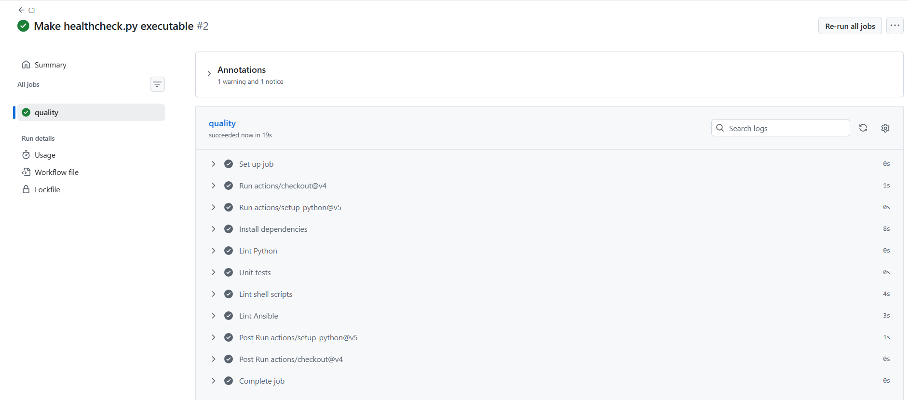

 
# Linux Server Health & Automation Toolkit

[](https://github.com/ADHITHYAAMARAGONDA/linux-health-toolkit/actions/workflows/ci.yml)


A small monitoring and automation toolkit for a single Linux server. Every five minutes it checks disk, memory, CPU load and systemd services, and sends a Discord alert when something is wrong. It stays quiet while the problem persists and tells you when it clears. It also ships a log-cleanup script, deploys to a fresh machine with one Ansible command, and is linted and tested by GitHub Actions on every push.

I built it after reading about an incident where a disk filled up and log ingestion silently stopped for three days because nobody was alerted. This project is my attempt at the kind of small, boring prevention that would have caught it on day one.

**Scope, stated honestly:** this is a single-host tool, tested on Ubuntu under WSL2 with systemd enabled. It is not a replacement for Prometheus and Grafana. It is meant for the hosts a full monitoring stack doesn't cover: a lab box, a jump host, a small VM.

---

## Contents

- [What it does](#what-it-does)
- [Architecture](#architecture)
- [Quick start](#quick-start)
- [Configuration](#configuration)
- [How alerting works](#how-alerting-works)
- [Security and hardening](#security-and-hardening)
- [Log cleanup](#log-cleanup)
- [Testing and CI](#testing-and-ci)
- [Demo](#demo)
- [Design decisions](#design-decisions)
- [Problems I ran into](#problems-i-ran-into)
- [Limitations and next steps](#limitations-and-next-steps)
- [Repository layout](#repository-layout)

---

## What it does

| Area | Behaviour |
|---|---|
| Disk | Checks every mounted filesystem. Skips squashfs, iso9660 and read-only mounts, which are always "100% full" and would raise false alarms |
| Memory | Alerts when used memory reaches a threshold |
| CPU load | Uses the 5-minute load average divided by CPU count, so one threshold works on any machine size |
| systemd | Reports any failed unit, plus a configurable list of services that must be running |
| Alerting | Discord webhook. One message per new issue, a cooldown for repeats, and a green RECOVERED message when it clears |
| Scheduling | systemd timer, not cron, with the service sandboxed |
| Deployment | One idempotent Ansible playbook. Running it twice changes nothing |
| Quality | ruff, pytest, shellcheck and ansible-lint run in CI on every push and pull request |

The script is read-only by design. It observes and reports, and never changes the system it runs on.

## Architecture



What happens during a single run:



## Quick start

You need an Ubuntu machine with systemd (a VM, or WSL2 with systemd enabled) and a Discord webhook. In Discord: Server Settings, Integrations, Webhooks, New Webhook, Copy Webhook URL. Treat that URL like a password.

**Deploy with Ansible:**

```bash
git clone https://github.com/ADHITHYAAMARAGONDA/linux-health-toolkit.git
cd linux-health-toolkit
sudo apt update && sudo apt install -y ansible

export DISCORD_WEBHOOK_URL='your-webhook-url'

sudo /usr/bin/ansible-playbook -i localhost, -c local \
  -e ansible_python_interpreter=/usr/bin/python3 \
  -e "discord_webhook_url=$DISCORD_WEBHOOK_URL" \
  ansible/playbook.yml
```

The trailing comma after `localhost` is required. It tells Ansible the value is an inline host list rather than an inventory file. Running with `sudo` and the system Python avoids the privilege-escalation prompt and keeps Ansible from picking up a virtualenv interpreter that has no apt bindings.

**Verify:**

```bash
systemctl list-timers healthcheck.timer
sudo systemctl start healthcheck.service
journalctl -u healthcheck.service -n 20 --no-pager
```

A healthy run logs `OK: 0 active issue(s), nothing new to report`.

**Try it without deploying anything:**

```bash
python3 -m venv .venv && source .venv/bin/activate
pip install -r healthcheck/requirements.txt

# print what would be sent, without sending or saving state
STATE_FILE=/tmp/demo.json DISK_THRESHOLD_PCT=0 python healthcheck/healthcheck.py --dry-run
```

## Configuration

Everything is controlled by environment variables. For the deployed service they live in `/etc/healthcheck/healthcheck.env`, which is created with mode `0600`.

| Variable | Default | Meaning |
|---|---|---|
| `DISCORD_WEBHOOK_URL` | (empty) | Webhook for alerts. Required unless using `--dry-run` |
| `DISK_THRESHOLD_PCT` | `80` | Alert when a filesystem is at least this full |
| `MEM_THRESHOLD_PCT` | `85` | Alert when memory use reaches this |
| `LOAD_PER_CPU_THRESHOLD` | `1.5` | Alert when the 5-minute load per CPU reaches this |
| `ALERT_COOLDOWN_SECONDS` | `3600` | Minimum time between repeat alerts for the same issue |
| `STATE_FILE` | `/var/tmp/healthcheck_state.json` | Where alert state is stored. The service uses `/var/lib/healthcheck/state.json` |
| `WATCH_SERVICES` | (empty) | Comma-separated services that must be active, for example `nginx,docker` |

The playbook writes the webhook, disk threshold and state path by default. To use the other options, add them to the env file and the next timer run picks them up.

**Exit codes:** `0` success or nothing to report, `1` the Discord send failed, `2` the webhook is not configured.

## How alerting works

A monitoring script that messages you every five minutes gets muted within a day, so the script decides *whether* to alert as carefully as it decides *what* to check.

Each check returns a list of findings, and each finding has a stable key such as `disk:/`, `memory`, `load`, `unit:systemd-binfmt.service` or `service:nginx`. The `reconcile()` function compares the current findings against a small JSON state file:

- **New issue:** alert immediately and record the time.
- **Same issue, still present:** stay silent until the cooldown (default one hour) has passed, then remind once.
- **Issue disappeared:** send a green RECOVERED message and forget it.
- **Discord unreachable:** exit non-zero and do **not** save state, so the alert is retried on the next run instead of being lost.

State is written to a temporary file and renamed into place, so a crash mid-write can't leave a corrupt state file. A missing or corrupt is treated as empty.

`reconcile()` is a pure function with no network or filesystem access. That is why it is the part with the most unit tests.

## Security and hardening

- **No secrets in the repo.** The webhook is passed at deploy time. The Ansible task that writes it uses `no_log: true`, and the env file is `0600`, owned by root.
- **The service runs unprivileged.** The unit uses `DynamicUser=yes`, so systemd creates a throwaway user for each run. It can write only to its own state directory, `/var/lib/healthcheck` (`StateDirectory=`).
- **Sandboxing:** `ProtectSystem=strict` makes the filesystem read-only for the service, `ProtectHome=yes` hides home directories, `PrivateTmp=yes` gives it a private `/tmp`, and `NoNewPrivileges=yes` stops it gaining privileges.
- **Read-only checks.** The script only reads from `psutil` and runs `systemctl` query commands.
- **If the webhook leaks,** delete it in Discord and create a new one, then re-run the playbook.

## Log cleanup

`scripts/cleanup_logs.sh` deletes `*.log` files older than a retention period. It supports a dry-run mode and passes `shellcheck`.

```bash
# preview what would be deleted
DRY_RUN=1 LOG_DIR=/var/log/myapp RETENTION_DAYS=14 ./scripts/cleanup_logs.sh

# actually delete
LOG_DIR=/var/log/myapp RETENTION_DAYS=14 ./scripts/cleanup_logs.sh
```

| Variable | Default | Meaning |
|---|---|---|
| `LOG_DIR` | `/var/log/myapp` | Directory to clean |
| `RETENTION_DAYS` | `14` | Delete files older than this many days |
| `DRY_RUN` | `0` | Set to `1` to list files without deleting |

To run it weekly, copy it to a stable location and add a cron entry (the playbook does not deploy it yet, see next steps):

```
0 3 * * 0 LOG_DIR=/var/log/myapp /opt/healthcheck/cleanup_logs.sh
```

## Testing and CI

```bash
pip install pytest ruff ansible-lint
ruff check .
pytest -q
shellcheck scripts/*.sh
ansible-lint ansible/playbook.yml
```

The unit tests cover the alert decision logic (new issue, repeat inside the cooldown, resolution) and the disk check, including the rule that read-only mounts are ignored. The disk tests monkeypatch `psutil`, so they behave the same on any machine, including the CI runner.

GitHub Actions runs the same four tools on every push and pull request. If a linter fails, the fix goes into the code rather than into an ignore list.

## Demo

Everything below was captured from a real run.

**Discord alert, then recovery.** The alert fired for a failed systemd unit (`systemd-binfmt.service`). Once the unit was no longer failed, the next run sent a green RECOVERED message for it.



**Dry run with a disk alert.** The VM's disk is 1 TB with almost nothing on it, so I lowered the threshold to `0` to force a finding. This is the message that would be sent.


**Unit tests passing.**



**The timer is active and scheduled.**



**Scheduled runs in the journal.**



**Log cleanup in dry-run mode.** It lists the 30-day-old file and deletes nothing.



**Ansible first run** changes everything it needs to.



**Ansible second run** reports `changed=0`. That is the idempotency check.



**CI passing** on every quality gate.



## Design decisions

**systemd timer instead of cron.** Output goes to journald with no extra setup, the unit can be sandboxed, `systemctl list-timers` shows exactly when the next run is, and a failed run shows up in `systemctl --failed` like any other unit.

**Alert on state change, not on every run.** Repeated identical messages train people to ignore the channel. A cooldown plus a recovery message gives a complete story for each incident: it started, it was still happening an hour later, it's over.

**Don't save state when the send fails.** If Discord is down, saving state would mark the issue as "already reported" and it would never be reported. Skipping the save costs one retry in five minutes.

**Load per CPU, using the 5-minute average.** A raw load of 4 means something different on 2 cores and 32 cores. The 5-minute window ignores short spikes.

**Findings with stable keys.** `disk:/` and `disk:/data` are separate issues with separate cooldowns and separate recovery messages.

**Small functions that return findings.** Each check is independent and trivial to test or extend. Adding a check means writing one function and adding it to the `CHECKS` tuple.

**Ansible over a shell installer.** The playbook describes the desired state, so it is safe to re-run, it is the documentation of what a server needs, and the second-run `changed=0` proves it.

**No extra tools.** The stack is deliberately small. Every piece is something I can explain line by line.

## Problems I ran into

These cost me time, and fixing them taught me more than the happy path did.

- **Ansible hung at the sudo prompt.** `-K` didn't work on a recent Ubuntu, and Ansible had also picked the Python inside my virtualenv, which has no apt support. Running the playbook under `sudo` with `ansible_python_interpreter=/usr/bin/python3` fixed both.
- **CI failed where my laptop passed.** ruff's `EXE001` rule rejects a file with a shebang that isn't executable. Git had stored `healthcheck.py` as mode `100644`. Fixing it with `chmod +x` and `git update-index --chmod=+x` taught me that git tracks the executable bit, and that a clean checkout is a good test.
- **False disk alerts.** The first version flagged mounts that were read-only by design, such as snap squashfs images that always report 100% used. The check now ignores read-only mounts, with a test to keep it that way.
- **A disk demo that wouldn't alert.** My WSL disk is 1 TB and nearly empty, so even a 1% threshold never fired. I set the threshold to 0 for the demo and said so in the caption.

## Limitations and next steps

Known limits:

- Single host, no history. For trends and dashboards, use Prometheus and Grafana.
- The webhook is passed on the Ansible command line, so it can appear in shell history and the process list on a shared machine.
- Tested on Ubuntu under WSL2, not on a range of distributions.
- `cleanup_logs.sh` is not yet deployed by the playbook.

Planned:

- Move the webhook into `ansible-vault`
- Deploy the cleanup script and its schedule from the playbook
- Multi-host inventory so one command provisions several servers
- A second alert channel such as email
- Expose `WATCH_SERVICES` and the other thresholds as playbook variables

## Repository layout

```
linux-health-toolkit/
├── healthcheck/
│   ├── healthcheck.py        # checks, alert decision logic, Discord sender
│   └── requirements.txt
├── scripts/
│   └── cleanup_logs.sh       # log retention with dry-run mode
├── systemd/
│   ├── healthcheck.service   # sandboxed oneshot unit
│   └── healthcheck.timer     # every 5 minutes
├── ansible/
│   └── playbook.yml          # idempotent deployment
├── tests/                    # pytest unit tests
├── docs/images/              # screenshots used in this README
├── .github/workflows/ci.yml  # ruff, pytest, shellcheck, ansible-lint
├── LICENSE
└── README.md
```

## License

MIT. See [LICENSE](LICENSE).

